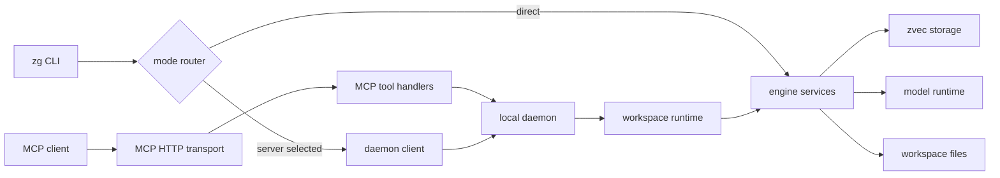

# Runtime and data flows

[Engineering guide](README.md) · [System map](system-map.md) · [Storage](storage-consistency.md)

This page describes the two implementations separately. They share product concepts, not a process, API implementation, or in-memory state. For detailed Rust crate invariants, see [`rust/ARCHITECTURE.md`](../../rust/ARCHITECTURE.md); for user-facing mode behavior see [Server and execution modes](../06-server.md).

## TypeScript / Node.js runtime

### Process entry and request routing



The executable is `src/cli/index.ts`; command argument handling and command orchestration live in `src/cli/`. Indexed CLI calls select server/direct behavior through `src/client/mode-router.ts`. In server mode, the client sends a daemon request; in direct mode it invokes engine operations in-process. MCP clients enter through `src/mcp/` and the daemon HTTP/runtime path. Managed ripgrep has a direct scan path and does not require the index or an embedding model. Exact command flags and tool schemas remain in source and `zg --help` / MCP schema tests.

Daemon responsibilities are split across HTTP hosting, runtime lifecycle, workspace runtime, model reuse, watcher coordination, and scheduled jobs (`src/daemon/`). Do not treat the daemon as a second search engine: it owns long-lived coordination and calls engine operations.

### Indexing lifecycle

```text
workspace root + selection/config
  → scanner and admission policy
  → extract file into searchable fragments
  → prepare text/vector content
  → resolve model and embed when required
  → stage/persist file and fragment records
  → publish workspace metadata/manifest
  → report status/progress
```

Implementation starts in `src/engine/pipeline/indexing/` and `src/engine/service/workspace-index.ts`; extraction is under `src/engine/extraction/`; model resolution and embedding are under `src/engine/models/`; persistence is under `src/engine/storage/` plus `src/engine/manifest.ts`. The selected file set and stored index configuration govern incremental work. The daemon watcher path schedules/coalesces refresh work; a full reconciliation is the recovery path when the watcher cannot establish complete change coverage. See `docs/04-pipeline.md` and `docs/06-server.md#refresh-behavior` for details and current CLI semantics.

### Indexed search lifecycle

```text
query + workspace scope
  → choose indexed route(s): lexical / vector / hybrid
  → retrieve candidate fragments
  → apply filters and route-specific ranking/fusion
  → map fragments to files and hydrate source previews
  → return grouped results + freshness/diagnostics
```

The engine search path is in `src/engine/pipeline/search/` and `src/engine/service/`; CLI/MCP presentation is an adapter and should not implement retrieval semantics independently. Search may use a background refresh policy in the daemon; freshness is explicit in result metadata. A stale/refreshing index is not automatically equivalent to direct filesystem grep.

## Rust runtime

Rust has separate CLI, daemon, protocol, MCP transport, native host, and engine crates. `rust/crates/zg/src/main.rs` assembles the executable; the CLI calls typed `zg_engine::ZvecGrep` operations either directly or through `zg-daemon` according to mode. The daemon's runtime and workspace scheduler own request/job coordination and call the engine; filesystem events come from `zg-host-native`; MCP maps external tool requests to engine operations in `zg-transport-mcp`.

### Rust indexing and publication

The engine indexing pipeline coordinates file discovery, extraction, model/runtime calls, and storage. Staged content is not made searchable until publication metadata makes it visible. The storage implementation uses file and fragment state, generations/read sessions, and recovery logic; a failed publication must not be described as a cross-collection atomic transaction. The implementation's stronger guarantee is an explicit visibility barrier plus retry/recovery, as documented in `rust/ARCHITECTURE.md` and `rust/docs/m1-handoff.md`.

Watcher-driven indexing is coordinated by daemon workspace runtime and freshness/status epochs. A late completion from an older scan must not overwrite a newer invalidation. Exact batching and retry behavior is implemented in `rust/crates/zg-daemon/src/workspace_runtime/` and `job_scheduler.rs`; host event semantics belong to `zg-host-native`.

### Rust query lifecycle

The typed API enters `zg-engine`, selects direct or indexed search, obtains a consistent read session for indexed state, retrieves/ranks candidates, then resolves fragment hits to stored file metadata and source ranges. Daemon/MCP/CLI layers format results but should not bypass engine filtering or hydration rules. See `rust/ARCHITECTURE.md` and inspect `pipelines/indexed_search/` plus `storage/read_session/` for current call paths.

## Cross-cutting flow invariants

- Cancellation and shutdown must reach scans, model preparation, embedding, storage work, and daemon jobs; avoid orphaned tasks.
- A refresh may publish only complete/validated results for its source revision. Late work cannot restore stale state.
- File-level/request-level errors may be isolated only where the API's structured error contract permits it; shared terminal failures must propagate.
- Result hydration must use the same snapshot/generation as candidate retrieval, rather than mixing candidates with newer metadata.
- Remote embedding is a separate data-egress boundary from local CLI/MCP authentication; consent policy applies before sending data remotely.
- Server/direct equivalence means equivalent search behavior, not identical process lifetime, background-refresh behavior, or resource reuse.

## Trace a behavior from entry to source

For a new behavior, follow one concrete path rather than reading only the top-level handler:

1. CLI argument or MCP schema/handler.
2. Mode router or daemon request dispatch.
3. Typed engine operation/service.
4. Pipeline and model/storage port.
5. Result formatting/hydration.
6. Unit, integration, compatibility, and failure-path tests at those boundaries.

Use the detailed source maps in [System map](system-map.md); names and flow labels here are navigation aids, not API contracts.