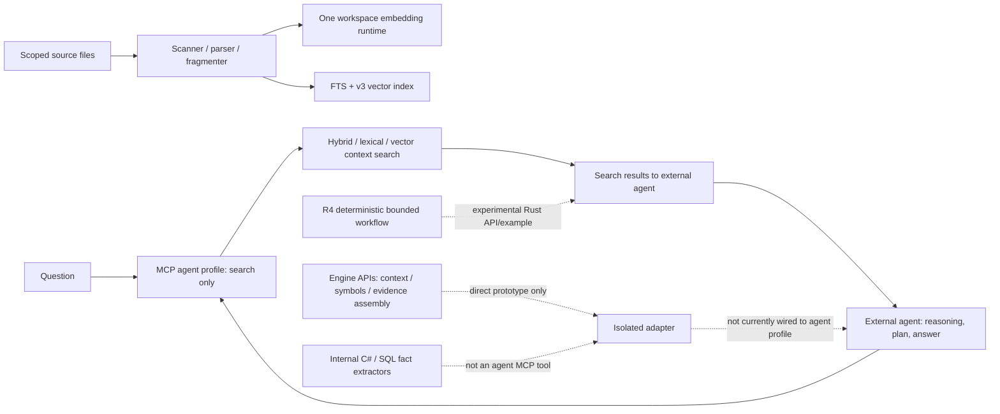

# R4 architecture & external-agent validation (2026-11-20)

**Gate A: PASS (static architecture/model inventory). Gate B: BLOCKED (no
privacy-approved, identifiable external inference runtime). Gate C: NOT MEASURED
(no answerer or independent grader run).** No inference, model download, source
egress, public API change, or new retrieval experiment was performed in this
pass.

## Synthesis

- The product boundary is already clear: zvec-grep retrieves/verifies static evidence; an external agent interprets the question, chooses investigation steps, and writes the answer. The Rust engine has no generation model.
- The engine currently offers an incomplete direct-agent surface: MCP's agent profile exposes only search; full MCP adds evidence, but there is no MCP symbols or typed-relations tool. R2/R3 facts are crate-internal.
- **Architecture-only recommendation:** prototype Option 3 behind an in-process, non-public adapter; keep Option 1 as the simple baseline and Option 2 as the existing deterministic baseline. This is a design-fit hypothesis, not a measured winner.
- Actual same-model paired answer-quality validation is blocked. The correctness rubric's missing C3 required steps are now frozen in a versioned addendum; answer quality remains NOT_MEASURED.

## Scope and provenance

Full pass was justified by the user request and by the interaction of indexing,
model runtime, R1 evidence, R2/R3 fact extraction, R4 workflow, MCP profiles,
and external-agent privacy/budget boundaries.

Inspected the canonical [RAG README](../../docs/rag/README.md) and
[implementation plan](../../docs/rag/implementation-plan.md); R0/R1, R2, R3,
R4 and correctness-contract documents; `zg-engine` model catalog/runtime,
indexing/search, public APIs, extraction modules and R4 workflow; MCP tool
profiles; the frozen R4 index manifest; prior experiment receipts; local model
artifact paths; and a bounded process/listener snapshot. No database, source
repository, or remote model was queried.

The containment checkpoint is preserved at commit
`86463826717ccdf11454755d99fa2acd57ce3c1c`, parent `0c9ba7ed26fe7c4ccfff4b06165ea85242dc95ab`,
which descends from requested base `7030bd7`. The checkpoint branch is one
commit ahead of `origin/work/r4-deep-opt-20261118`; that remote still points to
`0c9ba7e`. The working tree at audit start contained no uncommitted code.

## Current architecture

The last four nodes are existing engine capabilities/prototypes, not a currently
available end-to-end agent tool loop. There is no internal LLM call in the
workflow. `AgentPlan` is external input; the workflow then derives its own
anchors/routes, expands typed references, ranks candidates, and assembles a
verified pack.

| Phase/component | Confirmed current responsibility and boundary |
|---|---|
| R0 | Frozen static-code pilot and evaluation constraints. The source data is not runtime HRM data. |
| R1 | Context/search and evidence assembly/source validation are implemented. Full MCP has `zvec_grep_evidence`; the agent profile does not expose it. |
| R2 | C# facts and call/context/assignment extraction exist in `zg-engine`, on demand. |
| R3 | SQL definition and selected C#/SQL reference facts exist; extractors are crate-private, not a direct agent relation API. |
| R4 | `rag::workflow` is a public Rust module and `r4b_paired` is an experiment harness. The workflow is deterministic; there is no generation or external-agent connection in it. It still owns substantial query decomposition, expansion, ranking and selection heuristics. |
| R5 | Retrieval receipts exist, but external answer correctness has not been measured. |
| R6 | No public direct-agent tool integration/release is qualified by these results. |

R4 retains the containment fix in the checkpoint: a hit may widen only to the
method/procedure that contains it, with C#/SQL regression coverage. E3-only
reference-scope code was reverted. This is a correctness guard, not evidence
that an external-agent architecture wins.

## Model and runtime inventory

### What is configured, loaded, and cached are different states

| State | Evidence | Conclusion |
|---|---|---|
| **R4 index-bound model** | Frozen index manifest at `/home/masis/.cache/zvec-grep/r4-sql-symbols-20261118/corpus/.zvec-grep/manifest.json` names `local/potion-code-16m-v2`, CPU, 256 dimensions, text+code, 1024 max input tokens, and no embedding routes. | This is the single embedding model used by the R4 retrieval/index runs. It is not an answer-generation model. |
| **Live model at audit snapshot** | No `zg`, `llama-server`, Ollama, vLLM/SGLang or text-generation process appeared in the bounded process query; no listener was found on the usual local inference ports. No active `ZvecGrep` instance was available to query `runtime_snapshot()`. | No local inference runtime was observed; do not infer that a cached model is currently loaded. The snapshot cannot prove that an unusually configured/remote endpoint does not exist. |
| **Cached local artifacts** | `/home/masis/.zvec-grep/models/` has the Potion `model.safetensors` (32,490,072 bytes; SHA-256 `75cf7a6c2171b230ad19b1e7d8e0b1aee86da5a02af8e7cacedd9921d227623c`), tokenizer (1,024,340 bytes), and an EmbeddingGemma Q8 GGUF (333,590,944 bytes; SHA-256 `b5ce9d77a3fc4b3b39ccb5643c36777911cc4eb46a66962eadfa3f5f60490d63`). | Potion matches the R4 workspace. Gemma is cached, not evidence of current use. Cache presence alone is not execution. |
| **Other model/cache candidates** | Global Hugging Face cache contains additional repo/blob entries, but no link from those caches to an active `zg-engine` runtime was found. | Ownership/completeness/runtime use is unverified; they are not counted as active models. |
| **External reasoner** | The Pi-hosted model identity/version/config is not exposed through the available project/runtime tools. No permitted local or remote inference endpoint was identified. | Same external model across arms and private-source handling cannot be verified; no corpus/evidence was sent to a remote provider. |

The Rust model catalog is an **embedding catalog**, not a generator registry.
Its 14 default choices include local EmbeddingGemma, Qwen3 Embedding, BGE,
MiniLM, Potion Retrieval/Multilingual/Code, E5, Jina, GTE and Nomic entries,
plus Qwen-hosted text and vision embedding APIs. The hosted Qwen entries are
embedding endpoints, not reasoning LLMs, and would require explicit remote
authorization. The six E4 choices (Jina Q5 variants, EmbeddingGemma controlled
variants, and CodeRankEmbed Q8) are behind the non-default
`e4-experiment` feature; E4 remains research-only. Vulkan is an explicit
compute backend for embedding, not another model. Neither a neural reranker
nor a generative LLM is in the R4 execution path.

The design invariant is one embedding model per workspace. The R4 manifest
satisfies it. `IndexDescriptor` can represent content-kind routes, but the
indexing pipeline rejects a runtime with more than one unique model; keep that
restriction explicit rather than mistaking catalog alternatives for models
loaded together. The manager caches runtimes only within a live engine process.
Previous R4 `time` receipts measure whole-process CPU/RSS, not model-only PSS;
no per-model memory attribution was captured.

## Responsibility overlap and the three options

| Option | Current mechanism | Simplicity / duplication | Evidence and limitation |
|---|---|---|---|
| **1. External agent + ordinary hybrid search** | `agent_direct` MCP exposes only `zvec_grep_search`; it can request hybrid/lexical/vector search and symbol preference. | Smallest tool surface; agent owns iterative planning. | No direct structured symbol response, typed relations, or evidence-fetch/hash-verification tool in this profile. Repeated calls also need host-level cumulative budget enforcement. This is a sensible low-complexity baseline, but insufficient by itself to test the full evidence contract. |
| **2. External agent + R4 workflow** | Public Rust `run_with_plan` accepts `AgentPlan`; engine then runs DEFINE/DISCOVER/EXPAND/CHECK/FINAL, ranks/compacts and emits a verified pack. | Centralizes deterministic budgets and validation, but duplicates some of the agent's query decomposition, route choice, and evidence selection. The engine's policy is heuristic, not semantic reasoning. | Prior measurements are retrieval-only. `WorkflowBudget::default()` permits 12 tool calls/64 source reads, above the R0 target of 6/32; the benchmark supplies explicit tighter limits. It is per workflow run, not a cross-MCP-session ledger. |
| **3. External agent directly orchestrates search, symbols, relations, evidence** | `ZvecGrep` exposes context and symbol APIs; evidence assembly/validation exists; R2/R3 fact extraction is internal. Full MCP has evidence, but neither MCP profile has a symbols or relations tool, and the direct agent profile hides evidence. | Best ownership fit with the product decision: agent chooses what to ask next; engine remains deterministic retrieval/fact/evidence substrate. It could remove duplicated R4 planning/selection from the product path. | Not currently a usable agent-facing contract. A thin internal adapter can prototype it without changing public MCP/TypeScript/API contracts. Session budget, provenance, stale-source checks and byte caps still need one cumulative ledger. Extra round trips and answer quality are unmeasured. |

**Architecture-only recommendation:** use Option 3 as the next *hypothesis*,
implemented first as a non-public in-process adapter over existing APIs and
crate-internal facts; keep Option 1 as the baseline and Option 2 as the bounded
engine baseline. Do not remove the current workflow or publish new tools based
on this assessment. R0–R6 owner decisions favor external reasoning, but only a
same-model paired answer-quality run can show whether direct orchestration is
more accurate, cheaper, or simpler in practice.

## Findings

### F1 — Inference gate blocks the requested comparison

**Evidence:** no permitted inference runtime/endpoint or model identity was
found; the R4 harness uses only the workspace embedding model. **Impact:**
three arms cannot share a verified external model/version/config, and no
independent answer grader can be run under the required privacy boundary.
**Severity: High for Gate B/C; confidence: High for this environment snapshot.**
This is an operation blocker, not a code defect. No retry or remote egress is
authorized by this report.

### F2 — Agent MCP profile does not expose the typed evidence capabilities

**Evidence:** `AGENT_TOOL_NAME` is `zvec_grep_search`; `FULL_TOOL_NAMES` includes
evidence but no symbols/relations tool; `extraction` is private to
`zg-engine`. **Impact:** Option 3 cannot be tested through the existing agent
profile. **Severity: Medium; confidence: High.** Keep the prototype internal;
public surface work needs separate evidence and qualification.

### F3 — R4's external plan does not make the workflow agent-owned

**Evidence:** `AgentPlan` supplies queries/symbols/scopes, but `run_with_plan`
still derives question anchors, performs discovery/expansion/check, ranks, and
selects. **Impact:** Option 2 retains duplicate planning/selection heuristics;
its retrieval score is not an external-agent quality result. **Severity:
Medium; confidence: High.** Compare before simplifying; don't tune the heuristic
engine further in this mission.

### F4 — Per-run limits do not satisfy the full session budget contract by default

**Evidence:** default workflow budget is 12 calls/64 source reads, while the
frozen R0 pilot target is 6 calls/32 reads per investigation; search MCP calls
can be repeated. **Impact:** a multi-call external agent needs a host/session
ledger even if each engine call is individually bounded. **Severity: Medium;
confidence: High.** Any future adapter must enforce cumulative calls, reads,
bytes, rounds and wall-time across all three arms.

### F5 — Product design documentation predates the implementation

**Evidence:** `docs/rag/README.md` says the whole design/API is proposed and
lists typed extraction/evidence as missing; source now contains R2/R3 facts and
R1 evidence, but the direct agent profile remains narrower. The frozen dev JSON
also retains `ALL_24_CASES_FROZEN_B0_PENDING` while current R0 documents mark the
pilot frozen. **Impact:** a reader can mistake implemented internal capability
for an agent-facing product, or rely on stale split metadata. **Severity: Low;
confidence: High.** The dated status overlay below updates the architecture
reader's view without changing frozen data or the original plan.

## C3 freeze and prior experiment reproducibility

C3 required-step lists for D01–D12 are complete in
[`r4-task-correctness-c3-checklist-20261120.md`](r4-task-correctness-c3-checklist-20261120.md).
The addendum is frozen at SHA-256
`2bd4c63dff8b6638cad7db72a37ceeaaa6fd1031acf5f0cd15e3ed92ae8751bb`;
the dev case file and base contract hashes are included in that document.
It is a rubric preparation artifact, not an answer-quality result. Keep it away
from the answerer; use a separate grader context after answers and evidence
packs are frozen.

| Prior artifact | Retained/reproducible | Limitation |
|---|---|---|
| Baseline32 | Raw summary, JSON traces, timings, pre/mid/post resource snapshots and hash manifests under `/home/masis/.cache/zvec-grep/r4-evidence-20261119/receipt-baseline32/`. | No benchmark executable in that receipt; multiple attempt files should not be conflated. Whole-process resource counters only. |
| E1 fragment-anchor | JSON result, trace, timing, process snapshots and verified artifact hashes in `r4-e1-20261119/attempt-01`. | No executable or exact source patch retained; source hash alone does not reconstruct the build. |
| E2 context containment | Result/trace/resource receipts and executable retained in `r4-e2-20261119/attempt-02`; executable SHA-256 `229e13f1706fd37de67f730085d562f8a911789d996b0aa6ba8de281307d3e3a`. | Reproducible against the committed containment checkpoint, but still a single dev-split retrieval run, not an agent answer-quality trial. |
| E3 method/reference scope | Result/trace/resource receipts and executable retained; executable SHA-256 `75411d331ddb58b5afcb5e4288b9359ffd33bc0b79a8861d3f1c2652edc5e941`. | The exact E3 source patch/tree was not preserved; binary execution is reproducible, rebuild from source is not. E3-only source changes were reverted in the checkpoint. |

Receipt SHA checks passed for E1, E2 attempt-02 and E3 attempt-01. The prior
runs used the local Potion embedding model; they had no external answerer or
grader, no per-model RSS/PSS split, and no repeat-based variance estimate.
Do not treat retrieval recall, a valid citation trace, or preserved binaries as
answer correctness or external-agent validation.

## Status, risks, and safe next step

- **Gate A:** architecture/model inventory complete. Product invariant remains one embedding model per workspace and no in-engine reasoning model.
- **Gate B:** **OPERATION_BLOCKED** until an explicitly authorized, private-source-compatible inference environment is available and its model/version/config can be recorded. A “local CLI” alone is not proof of local inference. Do not route the private corpus or evidence to an unapproved provider.
- **Gate C:** **NOT_MEASURED**; C3 preparation is complete, but same-model answers and an independent grader are absent.
- **Public product changes:** none authorized or made. Do not expose symbols/relations, change default models, alter frozen cases, or tune R4 heuristics as a substitute for the blocked experiment.
- **Safe next action:** after a permitted model runtime is explicitly available, preregister one paired run with the same model/version/prompt and bounded host ledger for Options 1–3; keep query/prompt/packs and grader contexts blind as required by the frozen contract. If no permitted runtime is supplied, leave Gate B blocked and stop.

## Validation

- Claim sources are named above; live-runtime absence is stated as a bounded snapshot, not a universal claim.
- Scope stayed within architecture inventory, C3 checklist completion, evidence preservation and reports. No model download, source egress, new experiment, public contract, or frozen-case edit.
- Risks and the next safe action are explicit. This report is a dated implementation overlay; it does not silently rewrite the original RAG proposal or frozen benchmark data.
- No code changed in this pass; tests/builds were not rerun. Prior test/build evidence is recorded in the checkpoint report and receipts.

## References

- `docs/rag/README.md`
- `docs/rag/implementation-plan.md`
- `rust/docs/README-rag-r4.md`
- `rust/docs/r4-evidence-representation-results-20261119.md`
- `rust/docs/r4-evidence-representation-amendment-20261119.md`
- `rust/docs/r4-evidence-representation-amendment2-20261119.md`
- `rust/docs/r4-e3-results-amendment-20261119.md`
- `rust/docs/r4-task-correctness-contract-20261118.md`
- `rust/docs/r4-task-correctness-c3-checklist-20261120.md`
- `/home/masis/.cache/zvec-grep/r4-evidence-20261119/{receipt-baseline32,r4-e1-20261119,r4-e2-20261119,r4-e3-20261119}/`
- `rust/crates/zg-engine/src/{models/catalog/entries.rs,models/runtime/manager.rs,pipelines/indexing/pipeline.rs,pipelines/indexed_search/service.rs,api/symbols.rs,api/evidence.rs,extraction/mod.rs,rag/workflow.rs}`
- `rust/crates/zg-transport-mcp/src/lib.rs`

<!-- End report -->
